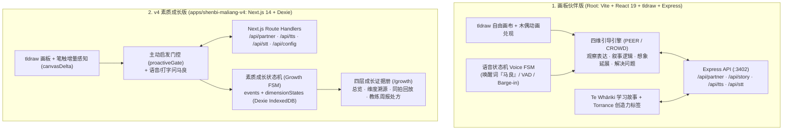

# 神笔马良 · 开放创造世界 (Open Creation World / Shenbi Maliang)

[](./LICENSE)
[](https://github.com/liuwenpinghaher-commits/open-creation-world/actions/workflows/ci.yml)

**神笔马良（Open Creation World）** 是一套面向 6–10 岁儿童的 **AI 对话式共创画板与素质成长证据系统**。核心理念是 **「孩子才是马良」**：AI 绝不替孩子画画、绝不替孩子起名、绝不替孩子编故事，而是基于 **对话式共读（PEER / CROWD）**、**苏格拉底式启发引导** 与 **Te Whāriki 学习故事（Learning Stories）**，通过语音唤醒（「马良」）与多模态视觉理解陪伴孩子边画边聊，并沉淀可溯源的素质成长证据册。

**Open Creation World (Shenbi Maliang)** is an AI co-creative drawing partner and longitudinal growth-evidence platform for children aged 6–10. Built around the core philosophy that **"The Child is the Creator"**, the AI never draws over the child's artwork or writes the story for them. Instead, it uses **Dialogic Reading (PEER / CROWD)**, **Socratic scaffolding**, and **Te Whāriki Learning Stories** to inspire observation, narrative logic, imagination, and creative problem-solving, while generating an evidence-backed Growth Portfolio for parents.

---

## 双版本演进架构 (Dual-Edition Repository Structure)

本仓库完整收录了「神笔马良」从 **创意画板伙伴版** 到 **v4 素质成长证据版** 的双版本工程实现：

| 版本模块 (Edition) | 目录路径 (Path) | 技术栈 (Tech Stack) | 核心定位 (Core Focus) |
| :--- | :--- | :--- | :--- |
| **1. 画板伙伴版 (Canvas Partner Edition)** | `/` (仓库根目录) | Vite 8 + React 19 + tldraw 4 + Express 5 | 自由画布作画、四维轮换引导引擎（PEER/CROWD）、完整语音交互状态机（Voice FSM / 唤醒 / Barge-in 打断）、7 种偶发木偶动作兑现（`fly`/`grow`/`spin`/`hop`/`walk`/`bounce`/`wobble`）、家庭多孩档案与 Te Whāriki 学习故事生成。 |
| **2. v4 素质成长版 (v4 Growth & Evidence Edition)** | [`apps/shenbi-maliang-v4/`](./apps/shenbi-maliang-v4) | Next.js 14 (App Router) + React 18 + tldraw 2 + Dexie (IndexedDB) | 素质成长状态机（4 核心维 + 3 扩展维）、局部笔触增量感知（`canvasDelta`）、三档主动启发门控（`proactiveGate`）、四层证据溯源下钻（L1 总览 → L2 维度 → L3 证据流 → L4 同拍回放）、教练波浪诊断（`coachWave`）与周报处方闭环。 |



---

## 核心特性 (Key Features)

### 1. 画板作画、笔触识别与多模态唤醒对话
- **「马良」唤醒与语音状态机**：支持语音喊「马良」唤醒（Porcupine 离线唤醒或 Web Speech 模糊匹配回落）、VAD 静音判停、播报中途开口打断（Barge-in）以及键盘打字无障碍回落。
- **全图 + 局部笔触增量视觉理解**：自动截取全画布与最新笔触局部特写（`detailImageDataUrl` / `canvasDeltaSummary`），让马良真正看懂孩子刚画下的每一笔。
- **克制的偶发动作兑现**：仅当孩子明确说出「让我的小鸟飞起来 / 变大 / 转圈」时，画布上的手绘角色才会触发对应木偶动画作为惊喜奖赏，绝不喧宾夺主。

### 2. 四维启发引导引擎与素质成长状态机
- **四维均衡轮换**：围绕 **观察与表达（`observe_express`）**、**叙事逻辑（`narrative_logic`）**、**想象延展（`imagination`）**、**创造性解决问题（`problem_solving`）** 四个维度，结合 `completion` / `recall` / `open` / `wh` / `distancing` 五类 CROWD 提问方式动态生成支架。
- **零排名、零打分的证据成长册（v4）**：
  - 每一次落笔、开口、追问与伙伴回应都会作为结构化事件（`drew`、`said`、`dimension_practiced`、`partner_replied`）写入本地 IndexedDB（`shenbi-maliang`）。
  - 家长端 `/growth` 提供 **L1 成长总览 → L2 维度趋势 → L3 作品证据流 → L4 同拍画布+对话回放**，并支持一键采纳教练焦点处方与导出 JSON 证据包。

### 3. 零商业 API Key 确定性演示模式 (Keyless Demo Mode)
- 两个版本均内置 **无密钥确定性 Demo 降级层**：
  - 未配置 `MODEL_API_KEY` / `VOICE_API_KEY` 时，服务端 `/api/partner`、`/api/story`、`/api/tts`、`/api/stt` 自动返回符合启发规范的中文苏格拉底追问、学习故事与静音 WAV 音频流，无需任何商业大模型密钥即可完整体验画板共创与成长证据册闭环。

---

## 快速开始 (Quickstart)

### 环境要求 (Prerequisites)
- **Node.js** >= 20
- **npm** >= 10

### 版本一：画板伙伴版（仓库根目录 · Vite + Express）

```bash
# 1. 安装依赖
npm install

# 2. （可选）配置百炼 DashScope 或兼容视觉大模型密钥；不配置则自动运行于确定性 Demo 模式
cp .env.example server/.env

# 3. 同时启动前后端开发服务（前端 http://127.0.0.1:3400 ，后端 http://127.0.0.1:3402）
npm run dev
```

### 版本二：v4 素质成长版（`apps/shenbi-maliang-v4` · Next.js 14）

```bash
# 1. 进入 v4 子目录并安装依赖
cd apps/shenbi-maliang-v4
npm install

# 2. （可选）配置环境变量；不配置则自动启用确定性 Demo 模式
cp .env.example .env.local

# 3. 启动 Next.js 开发服务器（默认 http://localhost:3100）
npm run dev
```

- **儿童画板**：访问 `/` 即可开始作画、点击「打字」或按住说话与马良互动。
- **家长成长证据册**：点击右上角「家长菜单 → 成长方案」（或访问 `/growth`）查看四维成长证据、维度下钻溯源、作品与对话、持续跟踪与周报处方。
- **家长设置中心**：访问 `/settings` 配置模型连接、语音参数、主动启发频率、孩子档案与安全策略。

---

## 环境变量说明 (Environment Variables)

| 变量名 | 适用版本 | 默认值 | 说明 |
| :--- | :--- | :--- | :--- |
| `MODEL_API_KEY` | 双版本通用 | 空（自动进入 Demo 模式） | 视觉/对话大模型 API Key（阿里百炼 DashScope 或 OpenAI 兼容密钥） |
| `MODEL_BASE_URL` | 双版本通用 | `https://dashscope.aliyuncs.com/compatible-mode/v1` | 模型 OpenAI 兼容接口地址（仅允许 `https://` 或本机 `127.0.0.1`/`localhost`） |
| `MODEL_ID` | 双版本通用 | `qwen-vl-max` | 多模态视觉大模型 ID |
| `VOICE_API_KEY` | 双版本通用 | 回落 `MODEL_API_KEY` | 语音合成 (`qwen-tts`) 与语音识别 (`qwen3-asr-flash`) 密钥 |
| `TTS_VOICE` | 双版本通用 | `Cherry` | 语音合成音色名称 |
| `NEXT_PUBLIC_PORCUPINE_ACCESS_KEY` | v4 素质成长版 | 空（回落浏览器语音唤醒） | Picovoice Porcupine 离线唤醒词 AccessKey |

---

## 测试与验证 (Testing & Verification)

### 1. 画板伙伴版（根目录）
```bash
# 运行全部单元测试 (Vitest)
npx vitest run src/test

# 生产构建校验
npm run build

# 运行真实 Chromium Playwright E2E 测试（默认使用独立端口 :18400）
npx playwright test
```

### 2. v4 素质成长版（`apps/shenbi-maliang-v4`）
```bash
cd apps/shenbi-maliang-v4

# 运行全部单元测试 (Vitest，覆盖成长状态机、教练环、质量门禁、Dexie 持久化等 19 个套件)
npm test

# Next.js 生产构建校验
npm run build

# 运行真实 Chromium Playwright E2E 测试（默认使用独立端口 :18410，覆盖画板、语音/打字问马良、成长证据册与无种子实时闭环）
npx playwright test
```

---

## 开源协议 (License)

本项目基于 [MIT License](./LICENSE) 开源，Copyright (c) 2026 Liu Wenping。
