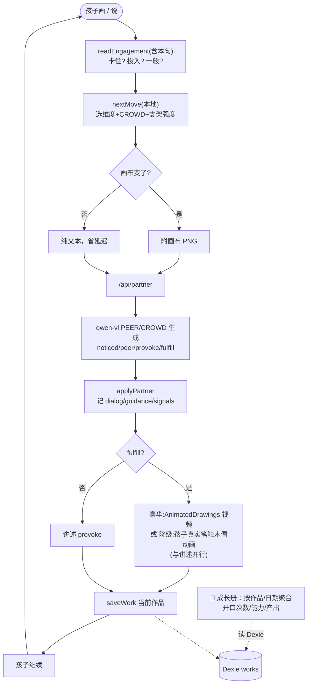

# 神笔马良 · 创作伙伴版 — 系统审计（更新流程图/架构图 + 全量问题）

> 日期：2026-06-19 ｜ 对象：重构为"支架式创作伙伴"之后的当前代码（commit `7944f9a6` 时点）
> 方法：基于当前源码逐处核对（非记忆），证据标注 `file:line`。

---

## 1. 系统架构图（现状）

```mermaid
graph TB
  subgraph 浏览器["浏览器 React 19 + tldraw"]
    Canvas["SketchCanvas · tldraw<br/>只有孩子的笔触（AI 不作画）"]
    App["App.tsx · 编排<br/>感知→引导→回应→偶发兑现"]
    Engine["guidance/engine<br/>四维均衡轮换 + CROWD + 节奏自适应(本地)"]
    Summary["guidance/summary<br/>成长册聚合"]
    Voice["voice/useVoice<br/>MediaRecorder 录音 / Audio 播放"]
    Fulfill["fulfill/behaviors<br/>孩子真实笔触整体木偶动画(tween)"]
    Figure["fulfill/figure<br/>AnimatedDrawings 适配(降级)"]
    Persist["store/persist<br/>Dexie 多作品 + localStorage 指针"]
    Store["store/sessionStore<br/>applyPartner: dialog/guidance/signals"]
  end

  subgraph 后端["Express 代理 :3402"]
    EP1["/api/partner"]
    EP2["/api/stt"]
    EP3["/api/tts"]
    EP4["/api/animate-figure (可选代理)"]
    Partner["partner.ts callPartner<br/>PEER/CROWD/Socratic prompt + sanitize + 重试"]
    VoiceSrv["voice.ts transcribe/synthesize"]
  end

  subgraph 云["阿里百炼 DashScope"]
    VL["qwen-vl-max 看画+听话理解"]
    ASR["qwen3-asr-flash STT"]
    TTS["qwen-tts TTS"]
  end
  ADS["(可选) Meta AnimatedDrawings<br/>Python 服务，用户自运行"]

  Canvas --> App
  App --> Engine
  App --> Store --> Summary
  App --> Fulfill --> Canvas
  App --> Figure --> EP4 --> ADS
  App --> Persist
  Voice -->|录音| EP2 --> VoiceSrv --> ASR
  App -->|图(变了才发)+话+history+move| EP1 --> Partner --> VL
  App -->|讲述文本| EP3 --> VoiceSrv --> TTS

  classDef gap fill:#ffe0e0,stroke:#d33;
  class Fulfill,App gap
```
> 红色：当前主要问题集中处（Fulfill 无对象定位；App 职责过重/无编排测试）。

---

## 2. 业务流程图（现状 · 激发为主 + 偶发兑现）



---

## 3. 全量问题清单（按"是否闭环 / 完善度"分级，含证据）

### 🔴 业务不闭环 / 功能缺口

**P1 · 兑现无"对象定位"，整张画一起动**
- `res.fulfill` 时对**画布全部 shape**做整体木偶动画（[App.tsx:164](../src/App.tsx#L164) `getCurrentPageShapeIds()`）。孩子说"让**小鸟**飞"，若画里还有树、太阳，会一起飞。多物体场景下"它/小鸟"指代无法落到具体笔触。
- 根因：未做笔触分组（spec 的 per-part rig 列为 P2 延后）。当前对"单一主体"的画成立，多主体不闭环。

**P2 · 空画布 / 无可动物时的"假兑现"**
- `if (res.fulfill)` 后直接 runBehavior，**不校验画布是否有可动笔触**（[App.tsx:157-170](../src/App.tsx#L157)）。空画布时 runBehavior 空转，但 AI 的 `provoke/speak` 可能已说"看它飞起来啦"——**说了没发生的事**，闭环假成功。

**P3 · 没有可回看的"故事/对话"产物**
- 成长册只聚合**抽象信号**（开口次数/能力次数/childSignal 摘要，[summary.ts](../src/guidance/summary.ts)），**不呈现真实对话**，也没有把孩子讲的故事沉淀成可回看的叙事。`session.dialog` 已存但 journal 未展示。
- 后果：产品承诺的"讲给家人看 / 回看"缺一个**创作叙事产物**，只剩冷冰冰的统计。

**P4 · 识别到的孩子语音不回显**
- 全流程**不显示孩子说了什么**（grep 确认 App 无 child 文本渲染，仅 `partner-bubble`）。STT 听错时，孩子/家长只看到 AI 答非所问，**无法察觉是听错了、也无法纠正**。儿童语音识别错误率本就高，这是反馈闭环缺口。

### 🟠 架构 / 健壮性

**P5 · 自动保存不感知动画/作品切换**
- `store.listen` 对所有 `source:'user'` 文档变更触发（[App.tsx:67](../src/App.tsx#L67)）。兑现动画每帧经 `silently`（仍是 user source）触发监听 → 高频回调；兑现结束后 `dirtyRef=true`，导致**下一拍即使孩子没画也重发一次图**（多花一次 qwen-vl 延迟/额度）。
- 防抖 1s 恰好掩盖了"动画中途存档"（每帧重置定时器），但这是巧合而非设计；动画时长若变短/丢帧有存到中间位姿的风险。
- 新作品切换 vs 在途防抖 saveNow 存在轻微竞态（低风险）。

**P6 · 豪华兑现视频无 onError**
- `<video onEnded>` 有，但**无 onError**（[App.tsx:264](../src/App.tsx#L264)）。坏 URL/解码失败时 onEnded 不触发，浮层只能靠点击遮罩关闭。

**P7 · App.tsx 职责过重 + 无编排层测试**
- App 同时管编排、持久化、成长册、语音、兑现（~270 行）。`runTurn` 的分支（dirty / fulfill / figure / 并行讲述）**无单测**，只有纯模块单测 + 2 个 e2e。回归风险集中在这个大文件。

**P8 · engagement 误判"埋头画"为卡住**
- `readEngagement` 只看**发言文本**（[engine.ts](../src/guidance/engine.ts)）。孩子安静地画很多、话很短 → 被判 `stuck` → 自动降难度，可能打断他的专注。

### 🟡 体验 / 延迟 / 验证 / 安全

- **P9 延迟**：每拍 ~3s 由 qwen-vl 决定，仅有"✨我在想…"视觉占位；真实流式语音(WS)未做（需 on-device 验证）。已实测换快模型无效（~2%）。
- **P10 首屏无引导空状态**：打开是空画布、无提示，孩子不知道该画/该说。
- **P11 产品假设未经真人验证**：核心 KPI（被好好提问是否让孩子创作更多）只有本地信号，无真机数据。**最大的"未闭环"其实是验证闭环**——所有教育学设计的有效性尚未在一个真孩子身上观测过。
- **P12 安全**：`/api/animate-figure` 代理到 env URL（受信环境，SSRF 风险低）；密钥服务端、错误不外泄、`.env` 已 gitignore（这些是好的）。
- **P13 测试守护**：除 ESLint 外无 CI；真实 API/浏览器 E2E 需手动触发（`test:real` / `test:e2e`）。
- **P14 进阶能力**：AnimatedDrawings 偏人形且需 Python，主链不含（符合 spec P3）；sketch-rnn 已论证不做。

---

## 4. 已闭环 / 完善的部分（平衡视角）

- 主回路闭环成立（单主体）：画/说 → 引导引擎选维度+提问 → qwen-vl 生成激发 → 记录 → 偶发兑现（孩子真实笔触动）→ 保存 → 循环。
- 引导引擎完整：PEER 循环 + CROWD 提问 + 四维均衡轮换 + 节奏自适应救场，真实 qwen 实测质量良好且不替孩子生成。
- 多作品持久化 + 成长册聚合可用；兑现降级稳健（AnimatedDrawings 不可用自动回退木偶，已测）。
- 工程底座干净：`tsc`/`eslint` 0、`vitest` 29 passed、`build` ok、真实 qwen 集成 5 passed、Playwright 2 passed。

---

## 5. 整改优先级建议

| 序 | 问题 | 价值 | 建议 |
|---|---|---|---|
| 1 | P2 假兑现 | 高·低成本 | fulfill 前校验画布有笔触；空则不动画、并让 prompt 在无可动物时不要说"它动了"（或前端兜底改话术） |
| 2 | P4 语音不回显 | 高·低成本 | 显示"我听到你说：…"，可点错重说；同时利于家长信任 |
| 3 | P3 可回看故事 | 高·中成本 | 成长册每张作品展开"对话/故事回放"；或一键"把今天的故事连起来读一遍" |
| 4 | P1 对象定位 | 高·高成本 | 点选分组（"点一下要动的东西"）作为务实第一步；真正 per-part rig 再说 |
| 5 | P5 保存感知动画 | 中·低成本 | 兑现期间挂 `suppressSave`，兑现后不置 dirty；按 diff 过滤动画帧 |
| 6 | P6 视频 onError | 低·极低 | 加 onError → setFigureVideo(null) |
| 7 | P7 编排测试 | 中·中 | 抽 `useSession`/`useCreations` hook，给 runTurn 关键分支补测 |
| 8 | P11 真人验证 | 最高 | 真机带一个 7 岁孩子跑一轮，按观察改——这是当前最该做的"闭环" |

> 结论：核心回路对**单主体**创作已闭环且质量良好；最值钱的两件事是 ① 补上 P2/P3/P4 这三个低成本的"小闭环漏洞"，② 做 P11 的**真人验证闭环**——其余（对象定位、流式语音）按真实反馈再投。
