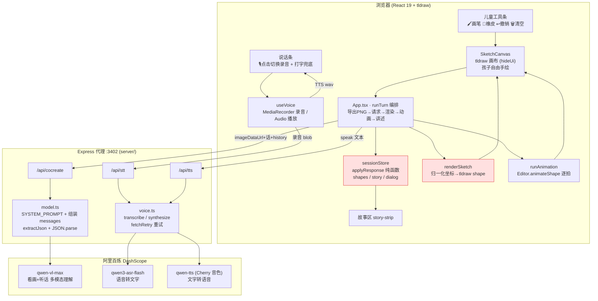
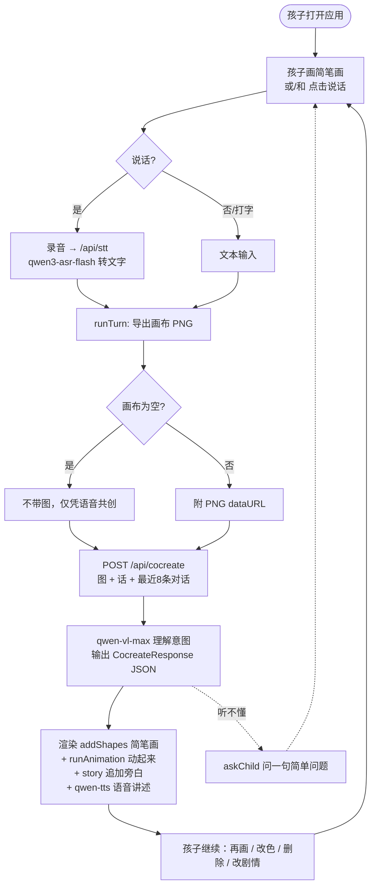
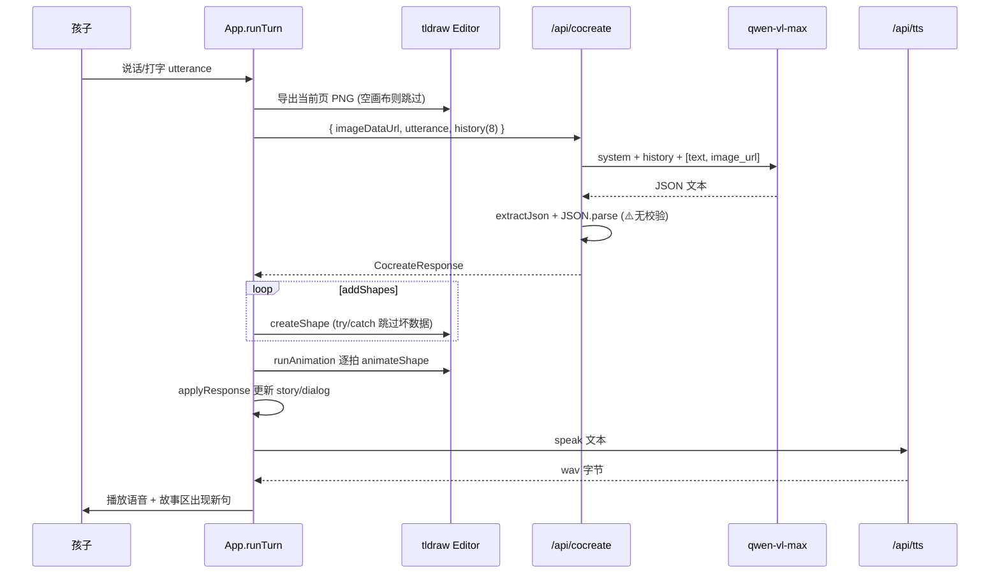

# 神笔马良 · 创造世界 — 系统深度分析与最佳整改方案

> 版本：v1.0 ｜ 日期：2026-06-19 ｜ 分支：`feat/magic-brush`
> 范围：基于仓库当前代码（`src/` + `server/`）、7 份规划文档、工程实测（typecheck / vitest）与公开最佳实践的全量分析。
> 结论先行：**端到端骨架已真实跑通、工程质量扎实，但产品最核心的差异化卖点（"AI 与孩子同源的统一简笔画风格"）尚未实现，且持久化、成长引导节奏、画布状态回传三处存在硬伤。** 详见第 6、7 章。

---

## 1. 项目定位（一句话）

让 6–10 岁孩子用简笔画 + 语音和 AI 共创会动的故事——"我的画真的活过来了"。当前实现处于 **新方向（神笔马良）阶段一：端到端最小可玩切片**，旧方向（因果模拟 / 修桥）已按设计文档 v3.1 删除。

技术现状：Vite + React 19 + TypeScript + tldraw 前端；Express 轻代理后端；AI 走 **阿里百炼 DashScope**（`qwen-vl-max` 多模态 + `qwen3-asr-flash` 语音识别 + `qwen-tts` 语音合成）。

---

## 2. 系统架构图



> 红色标注：`sessionStore` 与 `renderSketch` 是当前两处主要差距来源——状态未回传后端、风格未手绘化（详见第 6 章）。
> **缺失层（规划有、代码无）**：Dexie 持久化层、成长引导核心的节奏状态层、rough.js 手绘化层。

---

## 3. 业务流程图

### 3.1 核心共创循环（开放、可增删改、永不"结束"）



### 3.2 一拍（one turn）内部时序



---

## 4. 全功能介绍（现状逐项）

| 编号 | 功能 | 规划意图 | 当前实现 | 状态 |
|---|---|---|---|---|
| F1 | 简笔画画布 | 自由手绘、统一简笔画风格 | tldraw `hideUi` + `draw` 工具，极简儿童工具条 | ✅ 手绘可用；⚠️ 风格未统一 |
| F2 | 全程语音双向 | 在线 STT/TTS，听说自然 | 点击切换录音→qwen3-asr；qwen-tts(Cherry) 播放；空则降级文本 | ✅ 基本可用 |
| F3 | 多模态理解 | 看画+听话理解意图，可插拔 | qwen-vl-max，content 数组 text+image_url | ✅ 可用（选型与文档不同，见 §7） |
| F4 | AI 同风格简笔画 | **与孩子同源的统一简笔画** | 仅 ellipse/rectangle 几何形 + 虚线描边 | ❌ **核心卖点未达成** |
| F5 | 让画面动起来 | 2D 变换动画为主 | runAnimation→animateShape，移动/旋转/淡入 | ✅ 基本可用；⚠️"拍"语义缺失 |
| F6 | 故事共创增删改 | 开放循环、随时改 | append/rewrite + modify/remove shapes | 🟡 数据层支持，画布回传缺失致改动不可靠 |
| F7 | 保存与回看 | Dexie 本地保存、可继续 | **未实现**（dexie 已装未用） | ❌ 缺失，刷新即丢 |
| F8 | 成长引导核心 | 四维度 + 均衡节奏轮换 | 仅 system prompt 一句话，无状态/节奏 | ❌ 仅占位 |

**工程实测（2026-06-19）**：`tsc --noEmit` 通过（rc=0）；`vitest run` 13 passed / 4 skipped（真实 DashScope 联调测试默认 skip）；4 个单测文件覆盖 applyResponse / buildRequest / renderSketch / session-flow 纯逻辑。

**已做对的地方（值得保留）**：① `applyResponse` 是纯函数且有测试，状态演进清晰；② 全链路错误兜底扎实（坏 shape try/catch 跳过、TTS 空降级、zoomToFit 兜底、STT 没听清给友好提示）；③ `.env` 已被 `.gitignore`，密钥未入库；④ 点击切换录音的交互修复合理（避免按住松手丢失）。

---

## 5. 业务流程与规划的关系小结

- **现行基准 = 文档 3/6/7（神笔马良新方向）**；文档 1/2/4/5（因果模拟旧方向）已被设计文档 v3.1 正式推翻，但 tldraw/Dexie/事件日志思路/工程结构被显式保留复用。
- 旧因果内核（json-rules-engine / XState / capability / affordance / 修桥）**已删净**，代码中无残留——这一步执行到位。
- 当前实现对应阶段一计划（文档 6）的 Task 1–8，Task 中明确"留待后续"的项（Dexie、引导节奏、进阶生动化）即第 6 章的 P1 缺口。

---

## 6. 问题清单（按严重度分级，含代码证据）

### 🔴 高（影响核心体验 / 正确性）

**H1 · 核心卖点"统一简笔画风格"未实现**
- 现象：孩子用 perfect-freehand 自由笔触画；AI 只能输出 `geo: ellipse/rectangle`（[renderSketch.ts:56-65](src/sketch/renderSketch.ts#L56-L65)），`dash:'draw'` 只是虚线描边，并非手绘笔迹。两者明显不同源。
- `roughjs` 已在 `package.json` 依赖但**全代码零引用**（已验证）。规划 D1/D3/F4 的灵魂——"AI 画的和我画的一样"——目前体验不成立。

**H2 · 后端不知道画布上已有什么（状态未回传）**
- `buildRequest` 只发 `imageDataUrl + childUtterance + history(对话文本)`（[buildRequest.ts:8-12](src/cocreate/buildRequest.ts#L8-L12)），**从不发送 `session.shapes`**（已有图形及其 id）。
- 后果：AI 返回的 `modifyShapes`/`animation` 里的 `shapeId` 基本靠猜，命中已有元素的概率低；多轮"改色/删除/让它动"经常落空。这是 F6"增删改"不可靠的根因。

**H3 · LLM 结构化输出无校验、无重试**
- [model.ts:79](server/model.ts#L79) 直接 `JSON.parse(extractJson(text)) as CocreateResponse`，只兜了 `speak` 缺省。`response_format: json_object` 只保证"是 JSON"，不保证字段/类型合法（`addShapes` 缺 id、`kind` 非法、坐标非数值都会原样下传）。
- 前端 `createShape` 用 try/catch 跳过坏数据（[App.tsx:65-67](src/App.tsx#L65-L67)），表现为"AI 说画了但画布没出现"，且静默无提示。

### 🟠 中（影响完整性 / 可靠性）

**M1 · 无持久化** — F7/M7 规划的"保存、回看、继续"完全缺失，`dexie` 已装未用，刷新丢失全部创作。直接削弱"讲给家人看、反复回来玩"的成功信号。

**M2 · 成长引导核心仅占位** — F8 规划的四维度"均衡节奏、轮换避免重复"无任何实现；`guidanceIntent` 由 prompt 产出后，前端 `applyResponse` 也不消费/记录（[sessionStore.ts:13-48](src/store/sessionStore.ts#L13-L48)），无法做"上拍引导过 imagination，这拍换一个"。

**M3 · shape id 冲突** — AI 自定 id（如 `sun`、`cloud1`），`applyResponse` 直接 push 不去重（[sessionStore.ts:20](src/store/sessionStore.ts#L20)）；多拍后复用 id 会让 `createShape('shape:sun')` 抛错被吞，新形状画不出。

**M4 · 动画"拍"(`at`)语义未实现** — `AnimationStep.at`（第几拍）在 [runAnimation.ts:12-13](src/animation/runAnimation.ts#L12-L13) 仅用于排序后**串行**执行，同一 `at` 的多元素本应同时动却依次动，多元素协同动画无法表达。

**M5 · line/arrow/draw 退化为椭圆包围盒** — [renderSketch.ts:69-91](src/sketch/renderSketch.ts#L69-L91) 把线/箭头/自由曲线统一近似成一个细椭圆，且 SYSTEM_PROMPT 直接**禁止** AI 使用它们（[model.ts:6](server/model.ts#L6)）。AI 无法画线条（四肢、头发、连接、轮廓），表达力受限，也与 `SketchShapeSpec` 类型定义不符。

### 🟡 低（健壮性 / 体验细节 / 规范）

- **L1** 错误原文透传前端：三接口均 `json({ error: String(e) })`（[index.ts:19](server/index.ts#L19) 等），泄露上游报文。家用风险低但不规范。
- **L2** `useVoice.speak` 未 `revokeObjectURL`，长会话内存泄漏；且无法打断上一段 TTS，连点会叠播（[useVoice.ts:49-50](src/voice/useVoice.ts#L49-L50)）。
- **L3** "我在想…"仅改按钮文字，画布/故事区无 loading 反馈；CSS `.thinking` 类已写但 `App` 未用。
- **L4** TTS content-type 硬编码 `audio/wav`（[index.ts:35](server/index.ts#L35)），qwen-tts 实际音频格式不定，mime 可能不符。
- **L5** 多轮历史只传文本、不传历史图像；AI 看不到前几拍画了什么（叠加 H2 共同削弱连续性）。
- **L6** `PORT` 默认值 8787（[index.ts:42](server/index.ts#L42)）已是历史值，实际靠 `.env`=3402 覆盖；无 ESLint / 无 `lint` 脚本；真实联调测试默认 skip 无 CI 守护。

---

## 7. 与规划的差异矩阵

| 维度 | 规划（文档 3/6/7） | 实际实现 | 差异性质 |
|---|---|---|---|
| 多模态模型 | 豆包 `doubao-seed-2-pro`@火山方舟 | `qwen-vl-max`@阿里百炼 | **选型变更**（合理，但文档未同步） |
| 语音 | "在线语音模型 + 阶段一占位" | 真实 qwen3-asr-flash + qwen-tts | ✅ 超额完成 |
| 后端端口 | 8787 | 3402（避端口冲突） | 文档未更新 |
| 统一简笔画风格 | 核心卖点（rough.js 手绘化） | 几何形，rough.js 未用 | **关键缺口（H1）** |
| 简笔画原语 | draw/ellipse/rectangle/line/arrow/text | 仅 ellipse/rectangle，余者退化 | 缺口（M5） |
| 画布状态同步 | （隐含：AI 需知道画了什么） | 不回传 shapes | 缺陷（H2） |
| 结构化输出 | CocreateResponse schema | 无校验无重试 | 缺口（H3） |
| 成长引导核心 | 四维度+均衡节奏 | prompt 一句话 | 缺口（M2，计划性延后） |
| 持久化保存/回看 | Dexie | 未实现 | 缺口（M1，计划性延后至阶段三） |
| 进阶生动化 | sketch-rnn / Animated Drawings / Piper+Whisper | 未实现 | 符合预期（M8 进阶项） |

> 判定：选型变更、持久化、引导节奏、进阶生动化属**计划性演进/延后**，可接受；**H1/H2/H3/M5 属"阶段一目标内但未达成"的真实差距**，应优先整改。

---

## 8. 业界最佳实践（本项目相关，附来源）

**LLM 结构化输出**
- 2024.08 起 OpenAI 等主流厂商已用"约束解码 (constrained decoding)"保证 schema 合规；但**schema 合规 ≠ 语义正确**——合法 JSON 也可能内容全错。
- 推荐范式：用 Zod/Pydantic 做**结构 + 类型校验**，校验失败时**带错误信息重试一次**，已取代"生成后修补 parse 错误"的老做法。LLM 对"你上次输出缺了 X 字段"这类反馈响应良好。
- 多层兜底：JSON 解析失败时依次尝试去代码围栏 → 提取 JSON 区间 → 括号截断（本项目 `extractJson` 已做前两层，缺校验层）。

**儿童 + 语音优先 UX**
- 语音 (VUI) 应作为低龄儿童的**主导航**；熟悉、稳定的声音显著降低焦虑、提升信任（→ 固定 Cherry 音色是对的）。
- 3–7 岁对**视觉 + 听觉指令**的响应远好于文字；声音反馈是孩子最在意的反馈类型——应补"我在想…"的听觉/视觉 loading。
- 语音误解时，应**主动澄清 / 给重说提示 / 换种说法**，而非简单"我没听懂"（本项目 askChild + 友好 hint 方向正确，可加强）。

**阿里百炼**
- qwen-vl-max（2025-01-25 起属 Qwen2.5-VL 系列）支持**上下文缓存**——多轮共创可借此降本提速。
- 实时语音可用 `qwen3-asr-flash-realtime` + WebSocket 实时多模态协议，进一步降延迟；Qwen-TTS 双轨流式可达约 97ms 低延迟（适合"边说边出声"的未来升级）。

来源：
- [Reliable JSON from Any LLM: Pydantic + Zod (2026) — TECHSY](https://techsy.io/en/blog/llm-structured-outputs-guide)
- [Structured Output Isn't Reliable Output — Rotascale](https://rotascale.com/blog/structured-output-isnt-reliable-output/)
- [The guide to structured outputs and function calling with LLMs — Agenta](https://agenta.ai/blog/the-guide-to-structured-outputs-and-function-calling-with-llms)
- [Designing Safe and Engaging AI Experiences for Children (arXiv 2404.14218)](https://arxiv.org/pdf/2404.14218)
- [UX Design for Kids — Ramotion](https://www.ramotion.com/blog/ux-design-for-kids/)
- [Qwen-VL / 模型大全 — 阿里云百炼帮助中心](https://help.aliyun.com/zh/model-studio/models)
- [使用 WebSocket 调用实时多模态交互 API — 阿里云百炼](https://help.aliyun.com/zh/model-studio/multimodal-interaction-protocol)

---

## 9. 最佳整改方案

原则：**先补阶段一未达成的真实差距（P0），再做计划性延后项（P1），最后做体验打磨与进阶（P2）**。每条给出"改哪里 + 怎么验收"，按最小改动落地，不引入新框架（Zod 除外，结构校验的标准选择）。

### P0 — 让阶段一目标真正达成（建议本迭代）

**P0-1 · 回传画布状态给后端（修 H2，连带救活 F6 增删改）**
- 改 `buildRequest`：附带 `shapes: session.shapes`（id + kind + 当前坐标/颜色/文字的精简列表）。
- 改 `model.ts`：把现有 shapes 摘要拼进 user 文本（如"画布上已有：sun(黄圆,右上)、dog1(...)"），并在 prompt 中要求"`modifyShapes`/`animation` 的 `shapeId` 必须引用上述已有 id"。
- 验收：让 AI"把太阳变红 / 让小狗向右跑"，modify/animation 命中率显著上升；新增 `session-flow` 用例断言 shapes 进入 payload。

**P0-2 · 结构化输出 Zod 校验 + 重试一次（修 H3）**
- 在 `model.ts` 用 Zod 定义 `CocreateResponse` schema，`safeParse`；失败则把 Zod 错误信息追加为一条 user 消息重试一次，仍失败回退最小合法对象 `{understanding, speak:"我们接着画吧～"}`。
- 顺手过滤非法 `addShapes`（缺 id / kind 不在白名单 / 坐标非 0..1）而非下传让前端静默吞。
- 验收：构造一条坏 JSON（mock fetch）断言重试与回退；前端不再出现"说画了但没画"。

**P0-3 · 统一简笔画风格——接入 rough.js（修 H1，核心卖点）**
- 方案 A（最小、推荐先做）：给 tldraw geo/draw 形状统一 `dash:'draw'` + 适度抖动，并**让孩子的画笔与 AI 的描边同色板同粗细**，先把"视觉同源感"拉到及格线。
- 方案 B（落地真手绘）：新增一个轻量 tldraw 自定义 shape，用已装的 `roughjs` 渲染 AI 形状（hachure/sketch 风格），使 AI 笔迹与孩子手绘观感一致；坐标仍走归一化映射。
- 验收：并排截图，家长一眼判断"像同一个人画的"；至少消除"几何椭圆 vs 手绘"的违和。

**P0-4 · shape id 去重（修 M3）**
- `addShapes` 入站时若 id 已存在则改为 modify 或自动加后缀；`applyResponse` 去重 push。
- 验收：连续多拍复用 id 不再丢形状；加 1 个单测。

### P1 — 补齐计划性延后能力

**P1-1 · Dexie 持久化（修 M1 / 补 F7）** — 用已装 dexie 存 `SessionState`（shapes/story/dialog）+ tldraw snapshot，启动自动恢复，加"我的作品"列表。验收：刷新后画与故事仍在；能打开旧作继续。

**P1-2 · 成长引导核心节奏（修 M2 / 补 F8）** — `applyResponse` 记录每拍 `guidanceIntent.dimension` 历史；`buildRequest` 把"最近引导过的维度"传给后端，prompt 要求"轮换维度、非每拍引导"。验收：连续多拍维度分布均衡、不重复。

**P1-3 · 线条表达（修 M5）** — 评估 tldraw 当前版本 `line`/`draw` 原生 props 的稳定构造，至少恢复 `line`（连接/四肢/轮廓），解禁 prompt 对应原语。验收：AI 能画一条腿/一根连接线且不崩。

### P2 — 体验打磨与进阶

- **P2-1** "我在想…"可视 + 听觉反馈（用上 `.thinking`，可加一句轻提示音）。
- **P2-2** TTS 防叠播 + `revokeObjectURL`：播放前停掉上一段 Audio。
- **P2-3** 后端错误不透传原文，仅回友好码；保留服务端日志。
- **P2-4** 文档与代码对齐：更新 PRD/plan 的模型选型(qwen)与端口(3402)；补 README 启动说明。
- **P2-5** 加 ESLint + `lint` 脚本；把 integration 测试改为可选 CI（有 key 才跑）。
- **P2-6（进阶）** 评估 qwen 实时语音 WebSocket（降延迟）、sketch-rnn / Animated Drawings（M8）。

### 优先级一览

```mermaid
graph LR
    P0["P0 本迭代<br/>H2状态回传 · H3校验重试<br/>H1风格统一 · M3去重"] --> P1["P1 下迭代<br/>Dexie保存 · 引导节奏 · 线条"]
    P1 --> P2["P2 打磨<br/>反馈/防叠播/错误/文档/lint/进阶"]
    classDef p0 fill:#ffd6d6;classDef p1 fill:#fff0c2;classDef p2 fill:#e6f3ff;
    class P0 p0;class P1 p1;class P2 p2;
```

---

## 10. 一句话总结

骨架真、工程稳、方向清晰；但"统一简笔画风格(H1)""画布状态回传(H2)""输出校验(H3)"三处是横在"能演示"与"真好玩"之间的关键门槛——按 P0 四条整改后，阶段一的产品承诺才算真正兑现。
